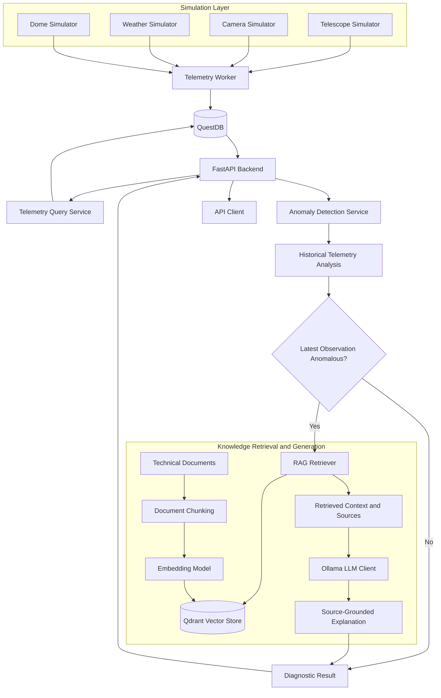

# ASTRA — Autonomous Observatory Intelligence & Decision Support Platform

ASTRA is an observatory data and AI platform designed to simulate observatory operations, collect and query telemetry, detect abnormal operating conditions, and generate source-grounded diagnostic explanations using Retrieval-Augmented Generation (RAG) and a Large Language Model (LLM).

The project brings together backend engineering, time-series data management, anomaly detection, vector search, LLM integration, simulation, and automated testing in a modular Python application.

> **Project status:** Active development. Core telemetry, anomaly detection, RAG retrieval, source-grounded answer generation, diagnostic API, and automated evaluation components have been implemented and tested.

---

## Table of Contents

- [1. Project Overview](#1-project-overview)
- [2. Problem Statement](#2-problem-statement)
- [3. Goals](#3-goals)
- [4. Key Features](#4-key-features)
- [5. System Architecture](#5-system-architecture)
- [6. End-to-End Workflow](#6-end-to-end-workflow)
- [7. Technology Stack](#7-technology-stack)
- [8. Core Components](#8-core-components)
- [9. Anomaly Detection](#9-anomaly-detection)
- [10. Retrieval-Augmented Generation](#10-retrieval-augmented-generation)
- [11. API Reference](#11-api-reference)
- [12. Knowledge Base](#12-knowledge-base)
- [13. Evaluation and Testing](#13-evaluation-and-testing)
- [14. Installation and Setup](#14-installation-and-setup)
- [15. Running the Application](#15-running-the-application)
- [16. Example Usage](#16-example-usage)
- [17. Limitations and Safety Considerations](#17-limitations-and-safety-considerations)
- [18. Future Improvements](#18-future-improvements)
- [19. Project Structure](#19-project-structure)

---

## 1. Project Overview

Observatories rely on multiple interconnected systems, including telescopes, cameras, environmental monitoring equipment, and dome mechanisms. Their operating conditions generate time-series telemetry that can help operators identify abnormal behavior and investigate potential equipment problems.

ASTRA provides a software environment for exploring this problem through simulated telemetry, time-series storage, anomaly analysis, and AI-assisted technical diagnostics.

Rather than returning only raw measurements or isolated alerts, ASTRA aims to connect operational data with technical documentation. When an abnormal condition is detected, the system can retrieve relevant knowledge and generate an explanation grounded in the retrieved sources.

The platform currently includes:

- Simulated observatory telemetry.
- Time-series persistence and querying through QuestDB.
- A FastAPI backend.
- Anomaly detection and historical analysis.
- A Qdrant-backed vector retrieval pipeline.
- Embedding-based semantic search.
- LLM-generated answers through an Ollama client.
- Source attribution for retrieved knowledge.
- A diagnostic API that combines telemetry analysis with RAG.
- Automated tests and evaluation utilities.

## 2. Problem Statement

Traditional monitoring systems often expose measurements, thresholds, and alerts without providing enough technical context to help an operator investigate the underlying issue.

For example, an increase in telescope motor temperature may be associated with several possible conditions. Looking at that measurement alone may not be sufficient to understand what to investigate next.

ASTRA explores how operational telemetry and technical documentation can be combined to support this investigation.

The central question is:

**How can a system detect unusual observatory behavior, retrieve relevant technical knowledge, and produce a useful, traceable diagnostic explanation without treating an AI-generated hypothesis as a confirmed root cause?**

ASTRA is a research and engineering platform for this workflow. Its simulated data and diagnostic outputs are intended for development and evaluation, not as a replacement for validated observatory safety systems.

## 3. Goals

### Engineering goals

- Build a modular backend using clear service boundaries.
- Simulate telemetry from multiple observatory subsystems.
- Store and query time-series observations efficiently.
- Separate telemetry ingestion, querying, anomaly analysis, and knowledge retrieval.
- Expose functionality through documented HTTP APIs.
- Test important components and their integration.

### AI goals

- Detect abnormal patterns in operational measurements.
- Retrieve technical documentation using semantic similarity.
- Generate answers using retrieved evidence.
- Include source information so users can inspect the supporting material.
- Evaluate retrieval quality and anomaly detection behavior.

### Decision-support goals

- Connect an observed condition with relevant technical knowledge.
- Help users identify reasonable next diagnostic checks.
- Distinguish observations from possible explanations.
- Avoid presenting an LLM-generated hypothesis as a definitive diagnosis.

## 4. Key Features

| Feature | Description |
|---|---|
| Telemetry simulation | Generates observations for telescope, camera, weather, and dome subsystems. |
| Time-series storage | Persists and queries telemetry through QuestDB. |
| Historical analysis | Retrieves recent observations for a selected subsystem. |
| Anomaly detection | Analyzes telemetry metrics and identifies abnormal observations. |
| Semantic retrieval | Finds relevant knowledge-base passages using embeddings and Qdrant. |
| RAG answer generation | Uses retrieved passages as context for an LLM response. |
| Source attribution | Returns references to supporting knowledge-base passages. |
| Diagnostic API | Combines telemetry analysis and AI-assisted explanations. |
| Automated testing | Covers API behavior, simulation, retrieval, answer generation, and evaluation utilities. |
| Evaluation utilities | Measures retrieval ranking and includes anomaly detection delay evaluation logic. |

## 5. System Architecture

The following diagram represents the main logical flow of the platform.



The diagram describes the intended diagnostic flow. Individual components can also be exercised independently through their respective APIs and tests.

### Architectural principles

**Separation of concerns:** Simulation, telemetry persistence, anomaly detection, retrieval, and answer generation are implemented in separate modules.

**Data-driven diagnostics:** Historical observations provide context beyond a single measurement.

**Retrieval before generation:** The RAG pipeline retrieves technical passages before asking the LLM to generate an explanation.

**Traceability:** Retrieved sources accompany generated answers, allowing users to inspect the supporting documentation.

**Testability:** Services and API routes have automated tests for expected behavior and error conditions.

## 6. End-to-End Workflow

### Step 1 — Telemetry generation

Simulators generate observations for the telescope, camera, weather station, and dome.

Telescope telemetry includes metrics such as:

- Tracking error.
- Motor temperature.
- Motor current.
- Vibration.

Other subsystems produce their corresponding telemetry fields.

### Step 2 — Persistence

The telemetry worker forwards observations to QuestDB through the project's ingestion layer.

QuestDB is used for storing and querying time-series measurements.

### Step 3 — Telemetry querying

The FastAPI backend exposes endpoints for retrieving the latest observation and a limited history for a given subsystem.

Historical observations can be used to analyze trends and identify previously detected abnormal points.

### Step 4 — Anomaly analysis

The diagnostic workflow analyzes recent telemetry using the anomaly detection service.

It returns the overall anomaly status, metric-level findings, and relevant diagnostic metadata.

Historical anomalous points and the latest observation are treated separately. The presence of an anomaly in historical data does not automatically mean that the latest observation is anomalous.

### Step 5 — Conditional knowledge retrieval

When the diagnostic workflow determines that the latest observation is anomalous, it can request relevant technical passages from the RAG retriever.

This avoids generating an unnecessary LLM explanation for every normal observation.

### Step 6 — Explanation generation

The retriever searches the vector store and returns relevant knowledge-base passages. The LLM client uses the retrieved context to generate a response.

The response can include source references so the user can trace the explanation back to the original documentation.

### Step 7 — Diagnostic response

The API returns the diagnostic result. Depending on the observed condition, the response may include anomaly findings, an explanation, and supporting sources.

The explanation is decision-support information; it is not proof of the underlying physical cause.

## 7. Technology Stack

| Technology | Role |
|---|---|
| Python | Primary implementation language |
| FastAPI | HTTP API and request/response validation |
| Pydantic | Data models and schema validation |
| QuestDB | Time-series telemetry storage and querying |
| Qdrant | Vector storage and semantic retrieval |
| Embedding model | Converts text into vectors for semantic search |
| Ollama | LLM integration for locally served model inference |
| Docker Compose | Local infrastructure orchestration |
| pytest | Automated testing |
| PowerShell | Development and operational commands on Windows |

PostgreSQL is also present in the broader project infrastructure. Its exact responsibilities should be documented alongside the implemented repository configuration rather than assumed from its presence in the stack.

## 8. Core Components

### 8.1 Simulation layer

The simulation layer models observatory subsystems and generates telemetry without requiring access to physical observatory equipment.

It includes telescope, camera, weather, and dome simulators, along with scenario logic for exercising abnormal operating conditions.

Scenario-driven simulation is particularly useful for testing whether downstream components react correctly to known abnormal inputs.

### 8.2 Telemetry service

The telemetry service separates telemetry models, ingestion, querying, and response schemas.

The query service retrieves the latest records and historical observations from QuestDB. FastAPI routes expose this functionality to external clients.

### 8.3 Anomaly detection service

The anomaly detection module contains detector logic, result models, and service-level orchestration.

It provides a structured way to represent anomaly findings and supports diagnostic workflows that operate on historical telemetry.

### 8.4 RAG service

The RAG service is divided into smaller components for:

- Document loading.
- Text chunking.
- Embedding generation.
- Vector-store interaction.
- Retrieval.
- LLM communication.
- Answer generation.
- Request and response schemas.

This modular structure makes it possible to evaluate retrieval separately from answer generation.

### 8.5 API layer

The API layer exposes telemetry, retrieval, answer-generation, health, and diagnostic functionality.

FastAPI also provides interactive API documentation, which can be opened at `/docs` when the application is running.

## 9. Anomaly Detection

Anomaly detection helps identify observations that deviate from expected operating behavior.

In ASTRA, the detection workflow works with telemetry metrics and historical observations. It can identify anomalous points in a history window and report whether the latest observation is itself anomalous.

This distinction is important:

- **Historical anomaly:** An earlier observation in the selected history window was flagged.
- **Latest anomaly:** The most recent observation was flagged.
- **Diagnostic escalation:** The latest observation meets the condition for invoking the RAG-assisted explanation workflow.

These states should not be conflated.

### Detection evaluation

The project includes evaluation utilities for assessing detection behavior. Anomaly detection delay is one of the supported evaluation concepts.

Detection delay measures how long the system takes to identify an anomaly after its onset. It helps evaluate not only whether a detector eventually detects a condition, but also how quickly it responds.

The evaluation should account for cases where an anomaly is detected immediately, detected after a delay, never detected, or absent from the ground truth.

The presence of an evaluation utility does not, by itself, establish a measured detection delay or prove production-level detection performance.

## 10. Retrieval-Augmented Generation

ASTRA uses Retrieval-Augmented Generation to connect telemetry-related questions with technical documentation.

Instead of relying exclusively on information encoded in the LLM, the system first searches the project's knowledge base for relevant passages.

### RAG pipeline

1. Load technical documents from the knowledge base.
2. Split documents into searchable chunks.
3. Generate embeddings for the chunks.
4. Store vectors and associated metadata in Qdrant.
5. Embed the user's query.
6. Retrieve semantically relevant passages.
7. Supply retrieved context to the LLM.
8. Return the answer together with source information.

### Why RAG?

RAG provides a mechanism for grounding generated explanations in project-specific documentation. It also makes it possible to inspect which passages were retrieved and whether those passages support the answer.

However, retrieval quality and answer quality are different things. A relevant passage can be retrieved while the final answer still misinterprets it. Both stages therefore require evaluation.

### Example diagnostic question

> What can cause telescope motor temperature and motor current to increase together, and what should an operator check?

The retriever searches the knowledge base for relevant technical passages. The LLM then uses those passages to explain plausible causes and appropriate checks, while preserving the distinction between a possible explanation and a confirmed root cause.

### Knowledge sources

The current knowledge base includes technical material such as:

- `knowledge/telescope/tracking_and_motor.md`

This document covers tracking error, motor temperature and current, possible contributing factors, baseline comparisons, diagnostic checks, escalation, and safety considerations.

## 11. API Reference

The following endpoints have been identified in the project. Request schemas and response fields should be checked against the current OpenAPI specification.

Base URL for local development:

`http://localhost:8000`

### Health

| Method | Endpoint | Purpose |
|---|---|---|
| GET | `/api/v1/health` | Checks whether the API responds. |

### Telemetry

| Method | Endpoint | Purpose |
|---|---|---|
| GET | `/api/v1/telemetry/telescope/{telescope_id}/latest` | Retrieves the latest telescope observation. |
| GET | `/api/v1/telemetry/telescope/{telescope_id}/history` | Retrieves telescope history. |
| GET | `/api/v1/telemetry/camera/{camera_id}/latest` | Retrieves the latest camera observation. |
| GET | `/api/v1/telemetry/camera/{camera_id}/history` | Retrieves camera history. |
| GET | `/api/v1/telemetry/weather/{station_id}/latest` | Retrieves the latest weather observation. |
| GET | `/api/v1/telemetry/weather/{station_id}/history` | Retrieves weather history. |
| GET | `/api/v1/telemetry/dome/{dome_id}/latest` | Retrieves the latest dome observation. |
| GET | `/api/v1/telemetry/dome/{dome_id}/history` | Retrieves dome history. |

History endpoints accept a `limit` query parameter, with a default of `100` and an allowed range of `1` to `1000`.

Example:

```http
GET /api/v1/telemetry/telescope/TCS-01/latest
```

### RAG search

| Method | Endpoint | Purpose |
|---|---|---|
| POST | `/rag/search` | Retrieves relevant knowledge-base passages. |

Example request:

```json
{
  "query": "What can cause telescope motor temperature and current to increase together?",
  "limit": 5
}
```

The precise optional fields should be confirmed against the current request schema.

### RAG answer generation

| Method | Endpoint | Purpose |
|---|---|---|
| POST | `/rag/answer` | Generates an answer using retrieved context and the configured LLM. |

Example request:

```json
{
  "query": "What can cause telescope motor temperature and current to increase together?",
  "limit": 5
}
```

The response includes a generated answer and source information according to the current response schema.

### Diagnostic analysis

| Method | Endpoint | Purpose |
|---|---|---|
| POST | `/api/v1/diagnostics/analyze` | Analyzes recent telemetry and conditionally invokes RAG for an anomalous latest observation. |

Example request:

```json
{
  "telescope_id": "TCS-01",
  "history_limit": 100,
  "rag_limit": 5
}
```

The response can include:

- Number of observations analyzed.
- Metric-level anomaly findings.
- Whether the latest observation is anomalous.
- An overall anomaly result.
- A generated explanation and sources when the workflow invokes RAG.

The actual fields and error responses are defined by the implementation and should be confirmed in `/docs`.

## 12. Knowledge Base

The knowledge base provides the technical context used by the retrieval and answer-generation pipeline.

For a diagnostic platform, the usefulness of the knowledge base depends on the quality, structure, and reliability of its documents.

Good knowledge documents should:

- Explain relevant metrics and their meaning.
- Distinguish normal behavior from abnormal behavior where reliable limits are available.
- Describe plausible causes without claiming certainty.
- Provide investigation steps and escalation guidance.
- Reference manufacturer limits and operational procedures where appropriate.
- Avoid unsafe recommendations or instructions that bypass protective mechanisms.

When adding documents, retrieval evaluation should be updated to check whether the new material can be found for relevant queries.

## 13. Evaluation and Testing

Automated testing is used to verify expected behavior across simulation, telemetry, anomaly detection, retrieval, answer generation, and API error handling.

### Automated tests

The latest reported full test run completed with:

**107 tests passed.**

This is a snapshot of the project's test suite at that point in development. The count can change as features and tests are added.

Run the full suite with:

```powershell
python -m pytest -v
```

### RAG retrieval evaluation

The evaluation utility in `tests.evaluation.evaluator` previously reported:

| Metric | Result |
|---|---:|
| Evaluation cases | 8 |
| Retrieval cutoff (`k`) | 5 |
| Mean Recall@5 | 1.000 |
| Mean Reciprocal Rank@5 | 0.875 |

**Interpretation:**

- **Recall@5 = 1.0:** Under the evaluator's current eight-case dataset and relevance labels, the relevant target was retrieved within the top five results for every case.
- **MRR@5 = 0.875:** The reciprocal rank of the first relevant result averaged 0.875 across those cases. This indicates that relevant results generally ranked near the top.

These results describe the current evaluation dataset, not general performance on every possible observatory query. A larger and more diverse evaluation set is needed for stronger conclusions.

### Further evaluation opportunities

- Increase the number and diversity of retrieval queries.
- Measure answer faithfulness to retrieved sources.
- Check whether citations support the claims made in generated answers.
- Evaluate retrieval under ambiguous or poorly phrased queries.
- Measure anomaly precision, recall, and false-alarm rates against labeled data.
- Measure detection delay across multiple anomaly scenarios.
- Test API behavior when the vector store or LLM is unavailable.

## 14. Installation and Setup

The repository is developed on Windows using Python 3.11, with infrastructure managed through Docker Compose.

The commands below are a starting point. The exact dependency file, environment variable names, Docker services, and ingestion command must match the current repository configuration.

### Prerequisites

- Python 3.11.
- Docker Desktop with Docker Compose.
- Git.
- An Ollama installation and a model compatible with the configured LLM client.
- The embedding model and vector-store configuration used by the project.

### Clone the repository

```powershell
git clone <repository-url>
cd ASTRA
```

### Create and activate a virtual environment

```powershell
py -3.11 -m venv .venv
.\.venv\Scripts\Activate.ps1
```

If PowerShell prevents script activation, use an approved activation method for your environment rather than changing system-wide execution policy unnecessarily.

### Install Python dependencies

If the repository contains `requirements.txt`:

```powershell
python -m pip install --upgrade pip
pip install -r requirements.txt
```

If dependencies are managed through another file or package manager, follow the project's actual configuration.

### Configure environment variables

Inspect the project's configuration and example environment files before creating a local `.env` file.

The configuration must provide the connection settings required by the application, including the relevant database, vector-store, embedding, and LLM settings.

Do not commit API keys, credentials, or other secrets to version control.

### Start infrastructure

From the repository root:

```powershell
docker compose up -d
docker compose ps
```

Confirm that the required containers are healthy before starting dependent application services.

### Initialize the knowledge base

Use the repository's implemented ingestion entry point to load and embed documents into Qdrant.

The exact ingestion command should be documented after confirming the current script and its configuration. Do not assume that starting the API automatically ingests the knowledge base.

## 15. Running the Application

### Start the API

If the current development entry point is `apps.api.main:app`, start it from the repository root:

```powershell
python -m uvicorn apps.api.main:app --reload
```

The API should then be available at:

- API health: `http://localhost:8000/api/v1/health`
- Interactive documentation: `http://localhost:8000/docs`

### Start the telemetry worker

The project's telemetry worker can be launched in a separate terminal using its implemented module entry point:

```powershell
python -m apps.workers.telemetry_worker
```

This command assumes that the worker module remains at that path in the current repository.

Keep the worker running while verifying that new observations appear in the telemetry endpoints.

### Verify RAG

Once the knowledge base and LLM are available, use the interactive API documentation to call `/rag/search` and `/rag/answer`.

A successful search should return relevant technical passages. A successful answer request should return a generated response with source information.

### Verify diagnostics

Call `/api/v1/diagnostics/analyze` with a valid telescope identifier and history parameters.

Test both normal and anomalous latest-observation cases. In the normal case, a generated explanation may be absent because the workflow is designed to invoke RAG conditionally.

## 16. Example Usage

A typical diagnostic investigation follows this sequence:

1. Retrieve the latest telescope telemetry.
2. Retrieve a window of historical observations.
3. Submit the diagnostic request.
4. Inspect metric-level anomaly findings.
5. If an anomaly is reported for the latest observation, inspect the generated explanation and its sources.
6. Review the underlying technical documentation before drawing operational conclusions.

For example, a question about rising motor temperature and motor current can be submitted to `/rag/answer`. The resulting answer can help identify plausible factors and suggest checks supported by the retrieved documentation.

The generated answer should not be treated as proof that any particular component has failed.

## 17. Limitations and Safety Considerations

ASTRA is a development and decision-support platform, not a validated production observatory control system.

Current limitations include:

- Telemetry is simulated rather than collected from physical equipment.
- Evaluation results depend on the size and quality of the test datasets.
- Retrieval metrics do not independently establish the factual correctness of generated answers.
- An LLM can produce an incorrect or incomplete explanation even when relevant passages are retrieved.
- An anomaly flag does not necessarily identify the root cause.
- Normal and anomalous behavior must ultimately be evaluated against appropriate operational baselines and manufacturer specifications.
- Production readiness would require additional reliability, security, observability, deployment, and operational validation.

The system must not be used to override interlocks, bypass safety procedures, or issue unvalidated operational commands to physical equipment.

## 18. Future Improvements

Potential next steps include:

### Data and anomaly detection
- Expand labeled telemetry datasets.
- Evaluate multiple anomaly detection approaches.
- Measure false positives, false negatives, and detection delay.
- Add richer cross-metric and cross-subsystem analysis.

### RAG and LLM evaluation
- Expand the retrieval evaluation dataset.
- Add citation correctness and answer-grounding metrics.
- Compare embedding and chunking strategies.
- Evaluate model latency and resource consumption.
- Improve handling of missing or conflicting source information.

### Backend and operations
- Improve configuration and environment validation.
- Add structured logging and request tracing.
- Improve service health and dependency checks.
- Document database initialization and data retention.
- Add repeatable end-to-end demo scenarios.
- Improve deployment reproducibility.

### Documentation and usability
- Add architecture and data-flow diagrams.
- Provide representative API responses.
- Document environment variables and troubleshooting.
- Add screenshots or a short recorded demonstration when a suitable interface is available.

## 19. Project Structure

The following is a logical overview of the repository. Exact filenames and any additional modules should be verified against the current branch.

```text
ASTRA/
├── apps/
│   ├── api/
│   │   ├── main.py
│   │   └── routes/
│   │       ├── telemetry.py
│   │       ├── rag.py
│   │       └── rag_answer.py
│   └── workers/
│       └── telemetry_worker.py
├── database/
│   ├── questdb/
│   └── postgres/
├── knowledge/
│   └── telescope/
│       └── tracking_and_motor.md
├── services/
│   ├── anomaly_detection/
│   ├── rag/
│   └── telemetry/
├── simulation/
│   ├── telescope/
│   ├── camera/
│   ├── weather/
│   ├── dome/
│   └── anomalies/
├── tests/
│   └── evaluation/
├── infrastructure/
│   └── docker/
├── docker-compose.yml
└── README.md
```

Some directories may contain additional modules not shown here. The final structure should be generated from the actual repository tree before publication.

---

## License

Add the project's chosen license here before publishing the repository publicly.

## Acknowledgements

ASTRA is an independent engineering project exploring the integration of observatory telemetry, anomaly detection, semantic retrieval, and source-grounded AI-assisted diagnostics.